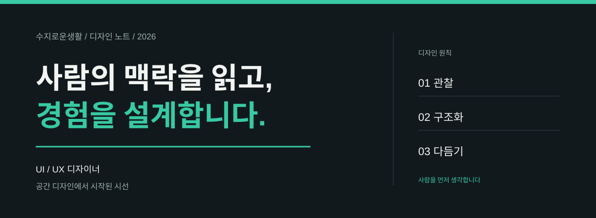

  

### 현재

- K3I 디발자 공부중 

- Codyssey 과제중

### 사용 도구

-  **디자인** &nbsp; Figma · Adobe Photoshop · Adobe Illustrator · AutoCAD · ketchUp · Enscape

-  **개발** &nbsp; Python · Streamlit · JavaScript · React · Next.js · Node.js · HTML · CSS  

-  **AI와 배포** &nbsp; OpenAI · Claude · Gemini · ChatGPT · Vercel · GitHub

### 오늘의 UI/UX 뉴스

<!-- DESIGN_NEWS:START -->
- [시스템 상태](https://uxdesign.cc/state-of-a-system-5c8473db1e9?source=rss----138adf9c44c---4) · UX Collective · 2026-11-02
- [일상적인 인터페이스 디자인에서의 덕행 윤리](https://uxdesign.cc/virtue-ethics-in-everyday-interface-design-5f2aca841781?source=rss----138adf9c44c---4) · UX Collective · 2026-11-02
- [반짝임 버튼, 디자인에 의한 자율성, UX에서의 AI 계산, MCP가 있는 Figma](https://uxdesign.cc/sparkle-buttons-autonomy-by-design-ai-reckoning-in-ux-figma-with-mcp-c93e38fa36e3?source=rss----138adf9c44c---4) · UX Collective · 2026-11-02
<!-- DESIGN_NEWS:END -->

