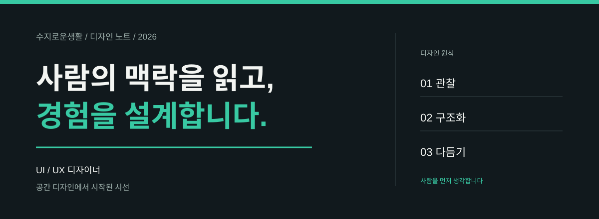

  

### 현재

- K3I 디발자 공부중 

- Codyssey 과제중

### 사용 도구

-  **디자인** &nbsp; Figma · Adobe Photoshop · Adobe Illustrator · AutoCAD · ketchUp · Enscape

-  **개발** &nbsp; Python · Streamlit · JavaScript · React · Next.js · Node.js · HTML · CSS  

-  **AI와 배포** &nbsp; OpenAI · Claude · Gemini · ChatGPT · Vercel · GitHub

### 오늘의 UI/UX 뉴스

<!-- DESIGN_NEWS:START -->
- [AI가 어디서나 작동한다면, 왜 우리는 그것을 보기 위해 출퇴근해야 할까요?](https://uxdesign.cc/if-ai-works-from-anywhere-why-are-we-commuting-to-watch-it-f903012aaa86?source=rss----138adf9c44c---4) · UX Collective · 2026-11-18
- [너무 클로드화됨](https://uxdesign.cc/too-claudified-9af067298b2a?source=rss----138adf9c44c---4) · UX Collective · 2026-11-18
- [연구자의 가치는 무엇인가요?](https://uxdesign.cc/what-is-a-researchers-worth-ea14c95c6d12?source=rss----138adf9c44c---4) · UX Collective · 2026-11-17
<!-- DESIGN_NEWS:END -->

